# Architecture

The system as built (2026-11-01, last release 4.4.1): Goal
mqucifer/sprint-metrics#891's target diagram, corrected to what the code
shows. This file is the repository's diagram of record: each Goal's target
diagram is drawn from it, and becomes it once the Goal is done (ADR 0036).
Update it when the code changes.

```mermaid
C4Component
    title sprint-metrics, as the repository has it, with the new parts of Goal 891 of mqucifer/sprint-metrics
    Boundary(pkg, "sprint_metrics package") {
        Component(svc, "service.py", "Stateful HTTP service and entry point: event intake (gains the 9th accepted event type 'filed', carrying the per-card filing facts: who filed it, what opened it, and, for cards filed in another repository, the project the card counts for; the intake api_version stays '1'), sprint registration, /range and /trend queries, /health, and the JSON schemas served at /schema/event and /schema/trend.")
        Component(card, "card.py", "Card dataclass and card parsing.")
        Component(metrics, "metrics.py", "Pure per-sprint metric calculations: cycle/lead time, throughput, WIP, blocked aging, first-attempt, failure breakdown, cost measures; ALL_METRICS gains the self-filed share measure.")
        Component(fld, "filed.py (new, #891)", "The per-sprint filed-split answer: how much of the sprint's filed work the crew gave itself — the total the crew filed, of which found by a role, from its own process, and split from already-filed work, beside what the Sponsor, the operator and anyone else filed; cards that can't be told apart reported as unknown, never guessed; null where the sprint holds no filing facts. Pure calculation, its /range attachment, its description fragment, and the self-filed share measure for /trend.")
        Component(win, "verdict.py", "Window verdict across the range: better/worse/flat per measure (up/down/flat for a measure with no better direction) plus standouts. Owns the measure registry, which gains the self-filed share with no better direction — the Goal reports the split, with no quality verdict and no standouts.")
        Component(rwk, "rework.py", "The per-sprint rework answer (sent backs, review/QA returns, by step) and its /range attachment.")
        Component(dst, "dora.py", "DORA's four measures per sprint and its /range attachment.")
        Component(tim, "time_splits.py", "Working time per session window, idle time against the registered sprint span, cost by story kind, model-time split refinement vs delivery; their /range attachments.")
        Component(thresholds, "thresholds.py", "Built-in default thresholds and flag calculation.")
        Component(report, "report.py", "API_VERSION (moves from '9' to '10' with the filed section and the new /trend measure) and metric display names.")
        Component(sr, "sprint_range.py", "Sprint-label parsing and the per-sprint range JSON; the top-level window object of the /range response.")
        Component(schema, "schema.py", "JSON Schema documents: the event intake gains the 'filed' type and its filing facts (filer, opener, project); the sprint-range schema gains the per-sprint filed section; the trend schema is unchanged, its metric staying a free string.")
        Component(store, "store.py", "Postgres persistence: board_events (new nullable filing-fact columns on 'filed' rows; 'filed' in the type CHECK) and sprints; the per-sprint roster and its /range attachment; a query for the sprint's stored filing facts, alongside the session-window, started-count, returned-row, epic/goal/kind, DORA and roster queries; the sprint's delivery-event gate excludes 'filed' rows.")
        Component(otel, "telemetry.py", "OpenTelemetry setup: tracer, logger, OTLP exporter.")
        Component(docgen, "_docs_gen.py", "Dev tool: regenerates the marked docs/ sections and the schemas/ files from the code, now including the filed answer.")
    }
    ContainerDb(db, "Postgres", "sprint_metrics schema: board_events and sprints; the filing facts as new nullable columns on the card's 'filed' event row.")

    Rel(svc, metrics, "computes per-sprint metrics from reconstructed cards")
    Rel(svc, fld, "per-sprint filed-split answers (its /range section) and the self-filed share for /trend")
    Rel(svc, win, "the window verdict and standouts over the range's per-sprint values")
    Rel(svc, rwk, "per-sprint rework answers")
    Rel(svc, dst, "per-sprint DORA answers")
    Rel(svc, tim, "per-sprint working-time, idle, cost-by-kind and model-split answers")
    Rel(svc, report, "API_VERSION")
    Rel(svc, sr, "range parsing and range JSON")
    Rel(svc, schema, "event-intake and trend schemas")
    Rel(svc, store, "upserts events (gains the 'filed' facts), answers queries (gains the stored filing facts)")
    Rel(svc, otel, "tracer and logger per request")
    Rel(sr, thresholds, "flags against the defaults")
    Rel(dst, store, "epic and goal links per story")
    Rel(tim, store, "session windows, sprint spans, card kinds and model splits")
    Rel(store, card, "reconstructs Card objects from stored rows")
    Rel(store, db, "all SQL")
    Rel(schema, win, "the measure registry names the window's verdict entries")
    Rel(docgen, metrics, "reads the calculate_* docstrings and ALL_METRICS")
    Rel(docgen, report, "reads _METRIC_COLUMNS")
    Rel(docgen, thresholds, "reads DEFAULT_THRESHOLDS")
    Rel(docgen, schema, "reads the schema documents")
    Rel(docgen, svc, "reads SERVICE_ENDPOINTS, the /range base and the per-answer description fragments, now including the filed answer's fragment")
    UpdateElementStyle(fld, $borderColor="green")
```

## Where the build differs from the target

- **`metrics.py`'s `metric_value` does not gain the self-filed share
  measure.** The target says `metrics.py` gains "the self-filed share
  measure" in `ALL_METRICS` and `metric_value`. In the build only
  `ALL_METRICS` (the set of accepted metric names) gains
  `self_filed_share_percent`; `metric_value` has no branch for it. The
  `/trend` value is computed in `service.py`'s trend handler, which calls
  `store.py`'s `query_filed_events` and `filed.py`'s
  `calculate_filed_split` and takes the split's percent — bypassing
  `metric_value`. That is the `Rel(svc, fld)` edge, which the diagram
  draws.
- **The trend schema document is unchanged.** The target says "the trend
  schema gains the self-filed share measure." The build's
  `TREND_SCHEMA` does not enumerate measure names (`metric` is a free
  string), so the measure enters through `ALL_METRICS` (the accepted
  metric names) and the `/trend` endpoint description in `SERVICE_ENDPOINTS`
  in `service.py`, not the schema document. The event-intake document
  gains the `'filed'` type and its filing facts, and the sprint-range
  document gains the per-sprint filed section, as the target has them.

Everything else in the target matches the build: `service.py`'s
`VALID_EVENT_TYPES` carries nine types including `'filed'`, the intake
accepts the filing facts (`filer`, `opener`, `project`) as optional top-level
string fields and keeps `api_version` "1"; `filed.py` computes the split
(the buckets partition the sprint: `crew_total` = found + from_process +
split + unknown, and the filer buckets sum to the sprint's total cards),
reports unknown cards as unknown rather than guessing, and returns null
where the sprint holds no filing facts — null meaning "no facts", distinct
from the zero crew counts of a sprint whose facts show the crew filed
nothing; the filed answer is computed from the sprint's filed rows,
independent of the delivery-event gate: `store.py`'s `sprint_has_events`
excludes `'filed'` rows, so a sprint whose only stored rows are `'filed'`
reads null for every delivery measure and appears in the window's
`no_data`, while still answering its filed split; `verdict.py`'s registry
entry for `self_filed_share_percent` carries no better direction (a percent
measure, whole precision), so its window entry holds movement (up, down or
flat) and the measure is excluded from the standouts; `report.py`'s
`API_VERSION` is "10" and `_METRIC_COLUMNS` gains the display name;
`schema.py`'s event-intake schema names `'filed'` in the type enum and the
three fact fields, and its sprint-range schema carries the per-sprint filed
section with the crew buckets, the total cards and the self-filed share
with its numerator and denominator; `store.py`'s DDL carries the new
nullable `filer`, `opener` and `project` columns (stored only on `'filed'`
rows, with the existing fill-NULL resend semantics), `'filed'` in the type
CHECK, and `query_filed_events` alongside the session-window, started-count,
returned-row, epic/goal/kind, DORA and roster queries; `sprint_range.py`,
`thresholds.py`, `telemetry.py` (tracer, logger, OTLP exporter) and the
docs tool are as the target draws them, the docs tool reaching the filed
answer's description fragment through `service.py`'s
`_RANGE_ANSWER_DESCRIPTIONS`, as it reaches every other answer's fragment.
