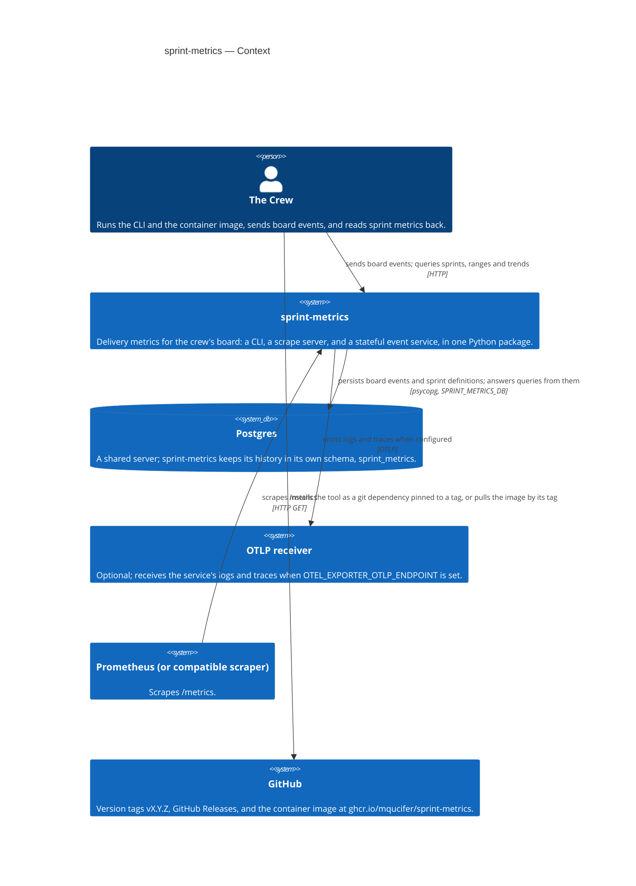

# Architecture

The system as the code has it (2026-10-22, v1.3.3), drawn as a C4 diagram in
Mermaid: context, containers, and components. This file is the repository's
diagram of record: each Goal's target diagram is drawn from it, and becomes it
once the Goal is done (ADR 0036). Update it when the code changes.

## Context

The crew is the only user. Nobody uses sprint-metrics directly: the crew runs
its CLI and its image, sends it board events, and reads its answers back. The
Sponsor sees its results second-hand, on the crew-presentation site.



## Containers

All three runtime modes live in one Python 3.12 package. The package is
released as a git tag and as a container image at
`ghcr.io/mqucifer/sprint-metrics`; the image's entrypoint is the same
`sprint-metrics` command, so the image runs any of the modes.

```mermaid
C4Container
    title sprint-metrics — Containers
    Person(crew, "The Crew")
    SystemDb(postgres, "Postgres", "Shared server. Owns the sprint_metrics schema: board_events (keyed by card_id, type, event_time) and sprints.")
    System(otlp, "OTLP receiver", "Optional.")
    System(prom, "Prometheus", "Scrapes /metrics.")

    Container_Boundary(boundary, "sprint-metrics", "Python 3.12 package, src/sprint_metrics; released at a tag and as a container image")
        Container(cli, "CLI", "sprint_metrics.cli", "One-shot report: reads card JSON from a file or stdin, prints a table, JSON, markdown, or Prometheus text. No database.")
        Container(scrape, "Scrape server", "sprint_metrics.serve, --scrape", "Serves /metrics (Prometheus text) and /json. Re-reads the cards file on every request. No database.")
        Container(service, "Stateful service", "sprint_metrics.service, --service", "Long-lived HTTP server on port 8080: POST /sprints and /events; GET /sprint, /range, /trend, /metrics, /schema/event, /health. Requires a database.")
    End_Boundary

    Rel(crew, cli, "runs sprint-metrics, reads the report", "stdout")
    Rel(crew, service, "POSTs board events and sprint definitions; GETs queries", "HTTP")
    Rel(prom, scrape, "GET /metrics, /json", "HTTP")
    Rel(prom, service, "GET /metrics", "HTTP")
    Rel(service, postgres, "upserts events, queries from them; reconnects if the server restarts", "psycopg")
    Rel(service, otlp, "logs and traces, one span per request", "OTLP")
```

## Components

The package is divided by concern so that parallel stories land in different
files. The CLI, the scrape server, and the stateful service share the metric
and formatting code; only the service touches the database, and all SQL lives
in `store.py`.

```mermaid
C4Component
    title sprint-metrics — Components
    Container_Boundary(pkg, "sprint_metrics package")
        Component(cli, "cli.py", "Entry point: argument parsing, file I/O; target of the sprint-metrics script and python -m.")
        Component(card, "card.py", "Card dataclass; card, sprint, and WIP-limit parsing.")
        Component(metrics, "metrics.py", "Pure metric calculations: cycle time, lead time, throughput, WIP violations, blocked aging, escalation rate, first-attempt rate, failure breakdown and its top causes, cost metrics.")
        Component(thresholds, "thresholds.py", "Default thresholds and flag calculation; --thresholds overrides.")
        Component(report, "report.py", "Single-sprint formatters: table, markdown, JSON, Prometheus; the markdown section and display helpers.")
        Component(sr, "sprint_range.py", "Sprint-label and range parsing; per-sprint range formatters (table, JSON, markdown).")
        Component(schema, "schema.py", "JSON Schema documents for the API: single-sprint, sprint-range, trend, and event intake.")
        Component(serve, "serve.py", "Scrape HTTP server: /metrics and /json, cards file re-read per request.")
        Component(svc, "service.py", "Stateful HTTP service: event intake, sprint registration, sprint, range, and trend queries; the service's /metrics and /health.")
        Component(store, "store.py", "Postgres persistence: the sprint_metrics schema DDL, idempotent event upsert, and the query functions. All SQL lives here.")
        Component(otel, "telemetry.py", "OpenTelemetry setup: tracer, logger, OTLP exporter, from OTEL_* environment variables.")
        Component(docgen, "_docs_gen.py", "Dev tool, not part of the public API: regenerates the marked (generated) sections of the docs/ files from the code.")
    End_Boundary
    ContainerDb(db, "Postgres", "sprint_metrics schema: board_events, sprints.")

    Rel(cli, card, "loads cards and WIP limits")
    Rel(cli, metrics, "selects metrics (--metrics)")
    Rel(cli, thresholds, "loads threshold overrides")
    Rel(cli, report, "single-sprint formatters")
    Rel(cli, sr, "sprint-range formatters")
    Rel(cli, schema, "--schema prints the JSON Schema")
    Rel(cli, serve, "--scrape starts the scrape server")
    Rel(cli, svc, "--service starts the stateful service")
    Rel(serve, card, "re-reads the cards file per request")
    Rel(serve, metrics, "computes the current metrics")
    Rel(serve, report, "Prometheus and JSON formatters")
    Rel(svc, metrics, "computes metrics from reconstructed cards")
    Rel(svc, report, "JSON formatter and API_VERSION")
    Rel(svc, sr, "range parsing and range JSON")
    Rel(svc, schema, "event-intake and trend schemas")
    Rel(svc, store, "upserts events, answers queries")
    Rel(svc, otel, "tracer and logger per request")
    Rel(store, card, "reconstructs Card objects from stored rows")
    Rel(store, db, "all SQL")
    Rel(docgen, metrics, "reads the calculate_* docstrings and ALL_METRICS")
    Rel(docgen, report, "reads _METRIC_COLUMNS")
    Rel(docgen, card, "reads parse_card")
    Rel(docgen, schema, "reads the schema documents")
    Rel(docgen, cli, "reads the argument help")
```

## Notes

- **The CLI and the scrape server are stateless.** They read card JSON from a
  file or stdin and hold no database. The stateful service is the only mode
  that requires Postgres; it exits non-zero at startup if
  `SPRINT_METRICS_DB` is unset or the database is unreachable.
- **History lives in Postgres, under the service's own schema.**
  `sprint_metrics.board_events` is keyed by `(card_id, type, event_time)`, so
  re-sending an event is safe; `sprint_metrics.sprints` holds the sprint
  definitions registered via POST /sprints. The service and CLI never
  construct queries outside `store.py`.
- **The event intake and the query responses are contracted by JSON Schema.**
  The schemas are published in `schemas/` at each release tag and served by
  the service at GET /schema/event; the response `api_version` is independent
  of the package version.
- **Telemetry is optional and service-only.** With
  `OTEL_EXPORTER_OTLP_ENDPOINT` unset the SDK stays a no-op and the service is
  fully functional.
- **A release is a published version.** A tag `vX.Y.Z` on this repository, a
  GitHub Release, and a container image at
  `ghcr.io/mqucifer/sprint-metrics:X.Y.Z` (plus `X.Y` and `latest`); see
  ADR 0002 and 0003 in [docs/decisions](decisions/).
- **`_docs_gen.py` is a dev tool.** It keeps the marked sections of
  `docs/metrics.md`, `docs/cards.md`, `docs/formats.md`, `docs/usage.md`,
  `docs/thresholds.md`, `docs/scrape.md`, and `docs/service.md` in step with
  the code; it takes no part in any runtime mode.
- **GET /trend is built but unused today.** Comparing sprints across a range
  is what this project is for, so the endpoint is to be made good, not
  retired.

User-facing documentation lives in [README](../README.md) and
[docs/](cards.md); decisions that apply to every Goal live in
[docs/decisions/](decisions/README.md).
