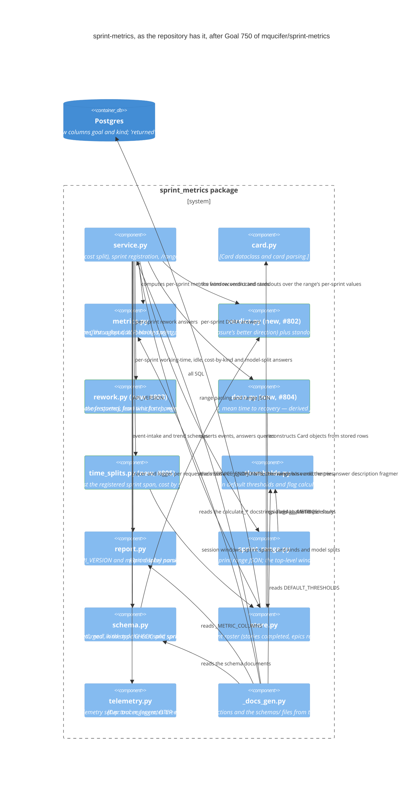

# Architecture

The system as built (2026-10-28, last release 4.2.0): Goal
mqucifer/sprint-metrics#750's target diagram, corrected to what the code
shows. This file is the repository's diagram of record: each Goal's target
diagram is drawn from it, and becomes it once the Goal is done (ADR 0036).
Update it when the code changes.

## Where the build differs from the target

- **The roster lives in `store.py`, not `dora.py`.** The target places
  "roster per sprint: stories completed, epics released, Goals achieved"
  inside `dora.py`. In the build `dora.py` owns only DORA's four measures
  (pure functions plus its /range attachment), and the roster is the
  `query_roster_data` SQL in `store.py`, with its /range attachment
  (`_attach_range_roster`) and description fragment there too — because all
  SQL lives in `store.py`. The diagram above moves the roster to `store.py`
  and draws `dora.py` as the four DORA measures.
- **`rework.py` has no store relation.** The target's
  `Rel(rwk, store, "returned rows and started counts")` is not in the build:
  `rework.py` is pure, and `service.py` itself pulls the returned rows
  (`query_returned_events`) and started counts (`query_started_count`) from
  `store.py` and hands them to `calculate_rework`. The diagram drops the
  edge; the two store calls ride `service.py`'s store relation.
- **The response `api_version` is "9", not "5".** The target says
  `report.py` moves 4 to 5 with the first release that changes a response.
  The build bumped the value once per response change: the per-sprint roster
  shipped as "5" (release 4.1.0), and the later /range additions — the DORA
  block with its four measures, the window verdicts and standouts, the
  working-time, cost-by-kind, model-time-split and idle answers — took it
  to "9" (release 4.2.0). Event intake keeps `api_version` "1"
  throughout, as the target has it.
- **The service serves the JSON schemas too.** The target's service
  description names /range, /trend and /health; the build also answers GET
  /schema/event and GET /schema/trend with the published JSON Schema
  documents, and the diagram names them.
- **`_docs_gen.py` reaches the /range answer text through `service.py`, not
  the answer modules.** The target's `Rel(docgen, win)`, `Rel(docgen, rwk)`,
  `Rel(docgen, dst)` and `Rel(docgen, tim)` ("reads the measure registry",
  "reads the rework docstrings", "reads the DORA docstrings", "reads the
  time-split docstrings") are not in the build: `_docs_gen.py` imports
  none of `verdict.py`, `rework.py`, `dora.py` or `time_splits.py`, and
  reads the calculate_* docstrings only in `metrics.py`. The per-answer
  description fragments are composed in `service.py`
  (`_RANGE_BASE_DESCRIPTION`, `_RANGE_ANSWER_DESCRIPTIONS`), and it is that
  composed text plus `SERVICE_ENDPOINTS` the docs tool imports. The diagram
  keeps the four answer-module fragments out of the docs tool's edges and
  labels its `service.py` edge accordingly.
- **`schema.py` reads the measure registry.** The target omits the edge, but
  `schema.py` imports `MEASURE_REGISTRY` from `verdict.py` to name the
  window's `verdicts` entries in the sprint-range schema. The diagram draws
  it.

Everything else in the target matches the build: the event intake accepts
the superset ('returned' alongside the existing types, optional top-level
`epic` and `goal`, optional `card.kind`, the finished event's cost payload
with its `model_time_split` sub-object); `verdict.py` owns the measure
registry (each scalar measure's better direction, unit and precision) and
judges the first data-bearing sprint against the last, skipping gap sprints,
with standouts (biggest improvement, worst dip), turns and the `too_short`
marker; `rework.py` owns the rework answer (sent backs, QA returns, by
step); `dora.py` derives all four DORA measures from epic/goal links and
the stored story events, an epic releasing in the sprint where its last
story's finished event is; `time_splits.py` owns the working-time, idle
(against the registered sprint span), cost-by-kind and model-time-split
calculations and, with the other answer modules, every /range attachment
and description fragment — `service.py` composes the response and holds no
per-answer attachment logic, so the two attachments the 749 record named as
left in `service.py` (model-time-split and idle) now sit in `time_splits.py`;
`store.py`'s DDL carries the new `goal` and `kind` columns, `'returned'` in
the type CHECK and epic/goal/kind on every row that carries them, with the
query functions for session windows, started counts, returned rows, card
kinds, model splits, sprint spans, DORA and roster data; `schema.py`'s
event-intake schema names 'returned', goal, kind and the cost split and its
sprint-range schema carries the new measures, the roster and the top-level
window (verdicts, biggest_improvement, worst_dip, turns, too_short);
`sprint_range.py` attaches the top-level window object; `report.py`,
`thresholds.py`, `telemetry.py` (tracer, logger, OTLP exporter) and the
docs tool's other reads (`metrics.py`'s docstrings and `ALL_METRICS`,
`report.py`'s `_METRIC_COLUMNS`, `thresholds.py`'s
`DEFAULT_THRESHOLDS`, the schema documents) are as the target draws them.
