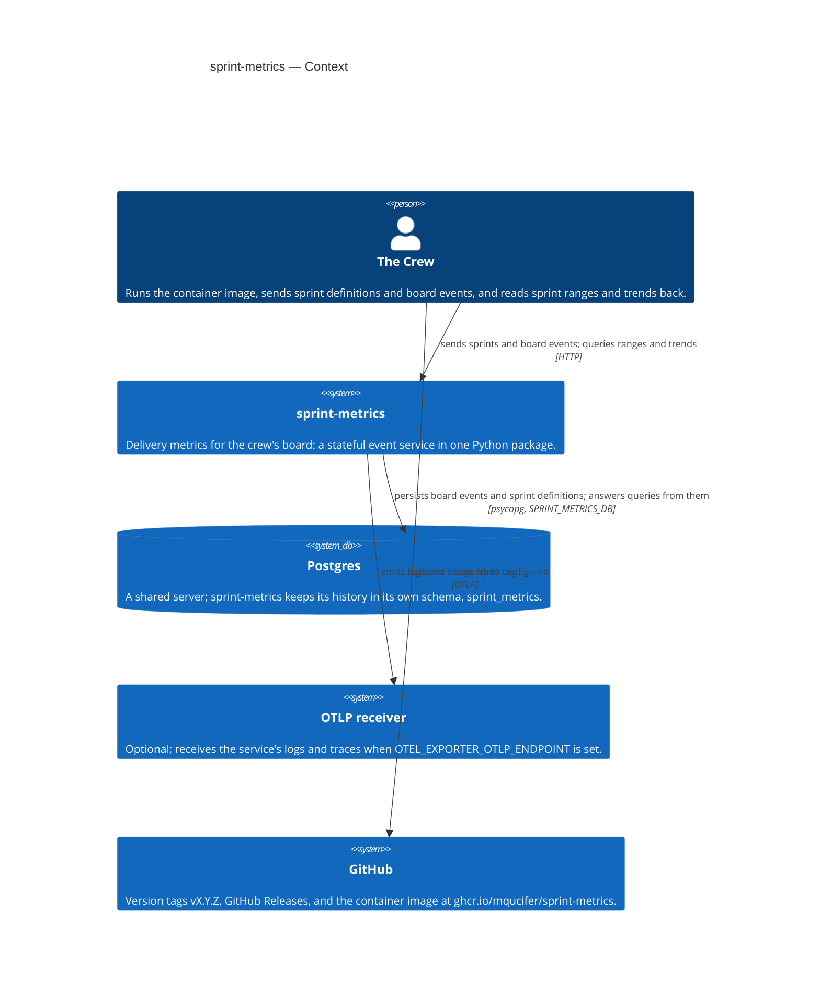
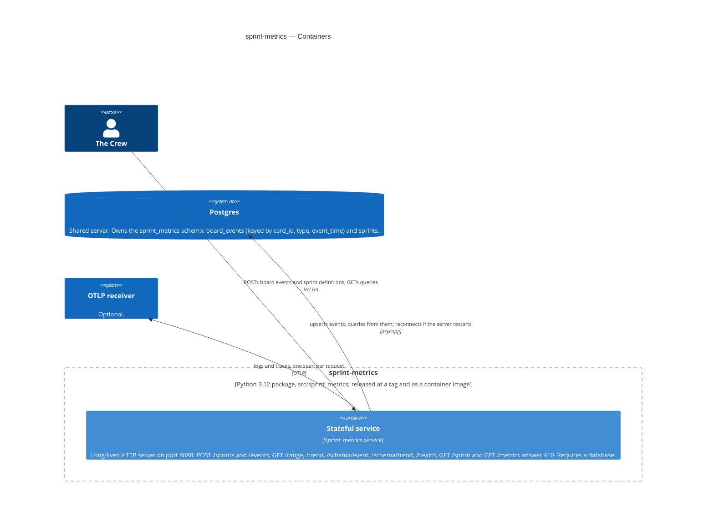
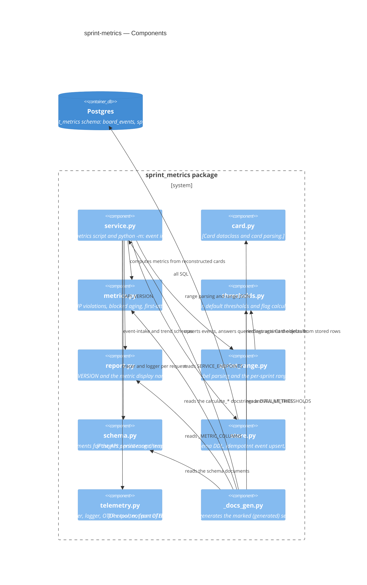

# Architecture

The system as the code has it (2026-10-25, 4.0.0), drawn as a C4 diagram in
Mermaid: context, containers, and components. This file is the repository's
diagram of record: each Goal's target diagram is drawn from it, and becomes it
once the Goal is done (ADR 0036). Update it when the code changes.

## Context

The crew is the only user. Nobody uses sprint-metrics directly: the crew runs
its image, sends it sprint definitions and board events, and reads its answers
back. The Sponsor sees its results second-hand, on the crew-presentation site.

## Containers

The package is one Python 3.12 service. It is released as a git tag and as a
container image at `ghcr.io/mqucifer/sprint-metrics`. The image's entrypoint is
the `sprint-metrics` command, which starts the service with no arguments and
refuses any argument: the command-line report tool and its scrape server were
retired in 2.0.0.

## Components

The package is divided by concern so that parallel stories land in different
files. Only the service touches the database, and all SQL lives in `store.py`.

## Notes

- **The service is the only mode, and it requires Postgres.** It exits
  non-zero at startup if `SPRINT_METRICS_DB` is unset or the database is
  unreachable.
- **History lives in Postgres, under the service's own schema.**
  `sprint_metrics.board_events` is keyed by `(card_id, type, event_time)`, so
  re-sending an event is safe; `sprint_metrics.sprints` holds the sprint
  definitions registered via POST /sprints. The service never constructs
  queries outside `store.py`.
- **The event intake and the query responses are contracted by JSON Schema.**
  The schemas are published in `schemas/` at each release tag and served by
  the service at GET /schema/event; the response `api_version` is independent
  of the package version.
- **Telemetry is optional and service-only.** With
  `OTEL_EXPORTER_OTLP_ENDPOINT` unset the SDK stays a no-op and the service is
  fully functional.
- **A release is a published version.** A tag `vX.Y.Z` on this repository, a
  GitHub Release, and a container image at
  `ghcr.io/mqucifer/sprint-metrics:X.Y.Z` (plus `X.Y` and `latest`); see
  ADR 0002 and 0003 in [docs/decisions](decisions/).
- **`_docs_gen.py` is a dev tool.** It keeps the marked sections of
  `docs/metrics.md`, `docs/thresholds.md`, and `docs/service.md` in step with
  the code, and rewrites the three JSON Schema files in `schemas/`; it takes
  no part in the running service.
- **GET /trend is built but unused today.** Comparing sprints across a range
  is what this project is for, so the endpoint is to be made good, not
  retired.

User-facing documentation lives in [README](../README.md) and
[docs/](metrics.md); decisions that apply to every Goal live in
[docs/decisions/](decisions/README.md).
